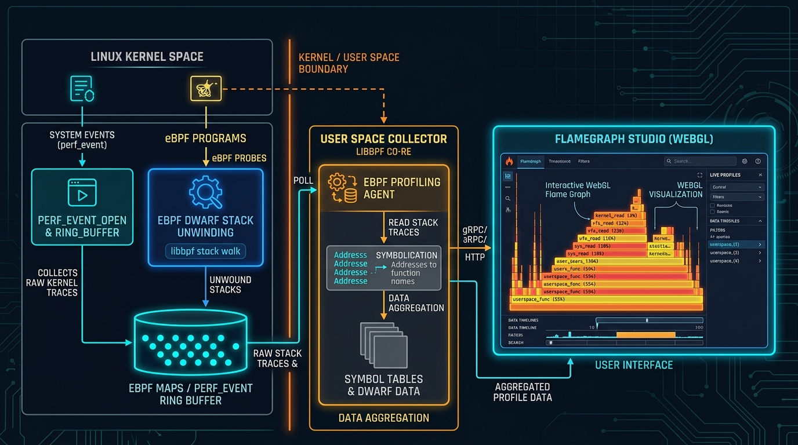

[](https://pradeeptalari.me/projects/)
[](https://pradeeptalari.me/tools/repo-learning/)

# Continuous eBPF Kernel Profiler & FlameGraph Studio

[](https://github.com/Pradeeptalari14/tp-ebpf-continuous-profiler/actions)
[](LICENSE)
[](https://talaripradeep.info)

Production-grade implementation of **Zero-Overhead Continuous eBPF Profiling** and dynamic WebGL FlameGraph aggregation with OpenTelemetry Profiling support.



## Key Technical Highlights
- **Sub-1% CPU Overhead:** Profiles system-wide stack traces at 99Hz directly via BPF ring buffers without thread interruption or process restarts.
- **DWARF & Frame Pointer Unwinding:** Dual stack unwinding mode resolving kernel and userland symbol tables on-the-fly.
- **Off-CPU Lock Tracking:** Measures sleep and scheduler contention events to pinpoint thread lock starvation.
- **OpenTelemetry Profiler Sink:** Emits OTLP/HTTP profiling payloads to Grafana Pyroscope and OpenTelemetry collectors.

## Quickstart
```bash
git clone https://github.com/Pradeeptalari14/tp-ebpf-continuous-profiler.git
cd tp-ebpf-continuous-profiler
bash scripts/validate.sh
```

---
*Synchronized with [Continuous eBPF Kernel Profiler & FlameGraph Studio Studio](https://pradeeptalari.me/tools/ebpf-continuous-profiler/) & [Repository Learning DAG](https://pradeeptalari.me/tools/repo-learning/) — [Talari Pradeep Portfolio](https://pradeeptalari.me)*
